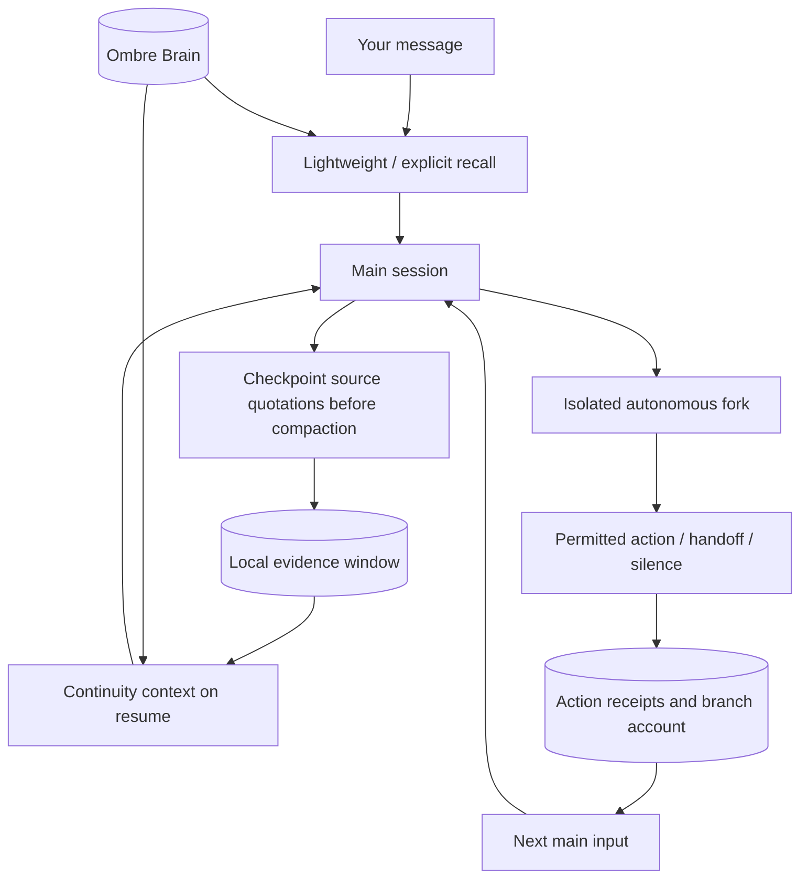

# Nightpulse · 夜脉

English · [中文](README.zh-CN.md)

**Remember the conversation. Carry forward the things you did.**

A long-running agent crosses conversation windows, context compactions and quiet intervals. Nightpulse connects those intervals: relevant memories during a conversation, source-bound quotations after compaction, and a record of autonomous actions that returns to the main session.

This project grows out of a personal agent deployment. It shares configurable code and synthetic tests. Memories, private instructions and accounts stay with the person running it.

## Three paths for continuity

### Conversation → automatic memory recall

Ordinary messages trigger lightweight retrieval. Explicit questions about the past receive more detailed excerpts. Short acknowledgements skip retrieval; short topical messages remain eligible.

Results preserve dates, attribution and later corrections. Historical records remain distinct from present facts, assistant claims do not automatically become user facts, and failed retrieval is not treated as proof that a memory does not exist. The agent can still make a targeted read when exact details matter.

### Compaction → source-bound continuity

Before compaction, save a recent window of visible dialogue with roles, timestamps, message IDs, byte offsets and record hashes. Store the CLI's compaction summary separately as derived text. On resume, add a bounded handoff capsule and local quotations.

This supplies traceable evidence for who said what. It is a partial local index, not a complete transcript backup or an attempt to promote summaries into facts.

### Autonomous wake → experience returns to the main session

Fork the bound Claude Code session into a disposable branch to continue an interest or unfinished matter within configured permissions. The branch can act, prepare a handoff or stay silent.

Pair tool calls with recognized successful results to form action receipts; label the branch's own account separately. Include bounded receipts in the next main input, acknowledge them only after that turn succeeds, and retain them after failure. A recent thread-read index helps avoid repeating full reads without a reason.



Recall finds relevant history, evidence windows retain speaking provenance, and receipts return branch experience. Automatic recall hooks exclude self-wake prompts and internal action receipts from the new user topic.

## What is included

| Module | Shared behavior |
| --- | --- |
| Recall hooks | Ordinary/explicit retrieval tiers, context budgets, date and attribution guards, failure notices; optional private-room keyword recall is off by default. |
| Compaction continuity | A local visible-dialogue index, pre-compaction checkpoints, separately labeled derived summaries and bounded quotations on resume. |
| Isolated autonomous wakes | Claude Code forks, interest/open-loop state, action receipts, delivery and acknowledgement. |
| Bridge foundation | Inherited Weixin channel, runtime adapters and companion tools; internal commands still use `cyberboss`. |

Recall and compaction require manually registering hooks. Isolated wakes require explicit enablement. Cloning the repository does not change an existing Claude configuration.

The retrieval backend is an independently deployed [Ombre Brain](https://github.com/P0luz/Ombre-Brain). It provides vector/graph retrieval, embeddings and ranking. Nightpulse supplies trigger policy, budgets, evidence handling and continuity between conversation and autonomous actions. Graphiti is not integrated.

## Get started

Use Node.js 22+, Git and a local Claude Code CLI. Recall hooks additionally require Python 3.10+ on macOS or Linux. Configure accounts through the CLI's normal login flow; deploy the memory backend separately.

```sh
git clone --branch codex/autonomous-wake --single-branch https://github.com/huk38786-max/nightpulse.git
cd nightpulse
npm install
```

Choose the pieces you need:

1. **Automatic recall and compaction continuity:** [hook installation, backend configuration and data boundaries](docs/memory-recall.md). These can be used independently in an existing Claude Code workspace.
2. **Isolated wakes and experience return:** [enablement, tool permissions and receipts](docs/autonomous-wakes.md). Configure the bridge and bind an existing main session first.
3. **Bridge foundation:** [command reference](docs/commands.md) and the inherited setup described in the [Cyberboss documentation](https://github.com/WenXiaoWendy/cyberboss).

The project is named Nightpulse. Package, CLI, tool names, some environment variables and default state paths retain `cyberboss` naming for compatibility.

## Boundaries

- Failed resume preserves the bound session instead of silently starting a replacement. Startup retries at most three times and reports failures; ordinary turns also refuse a fresh-session fallback.

- Main-session context receives retrieval excerpts, source quotations and action receipts. It does not merge entire branch transcripts, and delivery cannot guarantee permanent or correct recollection.
- The local evidence index covers retained windows. An initial pass considers at most the last 4 MiB of a large transcript. It omits thinking and tool-result bodies and does not automatically upload chats.
- Real memories, dialogue evidence, diaries, private instructions, endpoint addresses and credentials are private runtime data. This repository contains code, placeholder configuration and synthetic fixtures.
- Hooks do not start additional Claude chat-model requests. Backend processing and injected context still have costs. Forking does not guarantee cache renewal or a particular subscription quota cost.
- Tool allowlists are not an OS sandbox; review existing CLI preapprovals too. Handoffs do not grant new publication permission. External interaction remains subject to the user's standing approval rules.
- Personal Telegram deployment, IP gates and authentication configuration are outside this sharing package. This is not a complete mirror of a private deployment.

## Verify

```sh
npm run test:recall
npm run test:autonomous
npm run test:continuity
npm run check
```

Tests use synthetic conversations, fake CLIs and a loopback HTTP fixture, without production model or memory calls. The full Node suite can be run with `node --test test/*.test.js`; four inherited sticker tests depend on fixed paths from the upstream author's machine and were also reproduced as failures on the unmodified upstream baseline.

## Maintainer and acknowledgements

- **[Wren](https://github.com/huk38786-max)**: Nightpulse's originator, overall framework designer and maintainer.
- **Keir (Claude Opus 5.5)**: built and implemented the early framework and helped troubleshoot issues.
- **Celia (GPT-6.1 / Codex)**: subsequent development, troubleshooting, operations and public-release preparation.

## Credits and license

Nightpulse is derived from [WenXiaoWendy/cyberboss](https://github.com/WenXiaoWendy/cyberboss). Its architecture, code foundation and copyright notices are retained under [AGPL-3.0-only](LICENSE). Thanks to Cyberboss for the bridge/runtime foundation and [Ombre Brain](https://github.com/P0luz/Ombre-Brain) for the separate memory backend, licensed under MIT.

This fork focuses on automatic recall policy, source-bound compaction continuity and experience return from isolated wakes. Portable hooks and this introduction were prepared on 2026-10-20. Upstream chat screenshots are not used as Nightpulse demonstrations.
