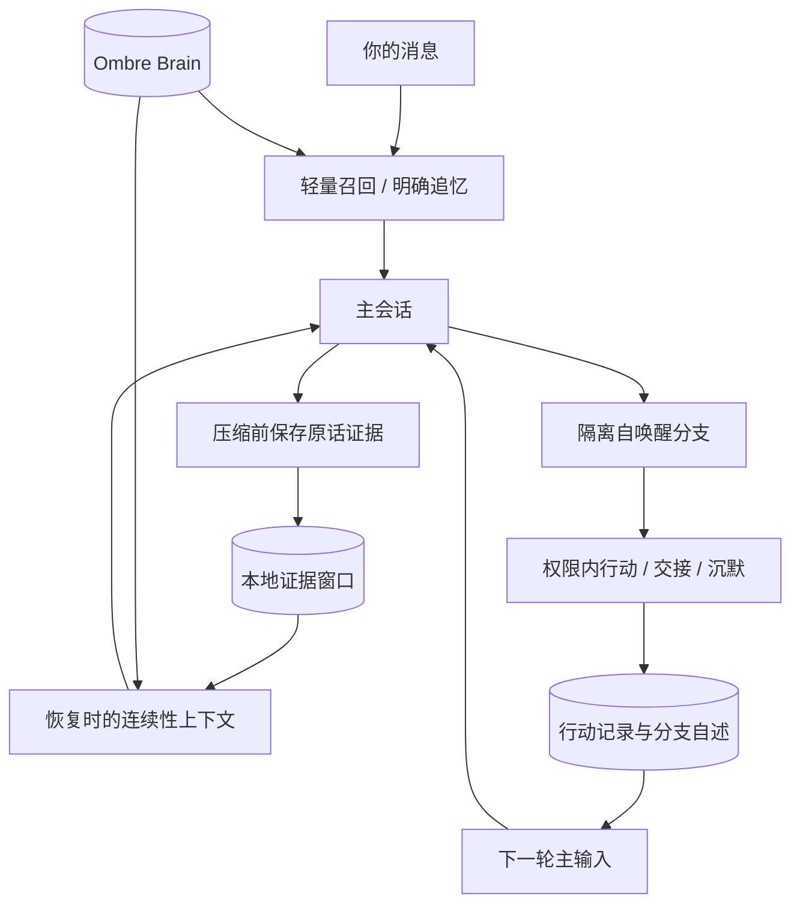

# Nightpulse · 夜脉

中文 · [English](README.md)

**记住聊过的，也接得上自己做过的。**

长期运行的 Agent，会跨过很多个对话窗口、上下文压缩和独处的间隙。Nightpulse 想把这些间隙接起来：聊天时想起相关往事，压缩后还能回看有出处的原话，自主醒来做过的事，也能带回与你继续对话的主会话。

它从一套实际使用的个人 Agent 系统中整理而来。这里分享的是可配置的程序和合成测试；记忆、私人规则和账号留在部署者自己手里。

## 三条接续路径

### 聊天 → 自动记忆召回

普通消息触发轻量检索；明确问“还记得吗”“上次说过什么”时，返回更多相关片段。简短应答会跳过检索，简短但有话题的消息仍可召回。

召回保留日期、人物归属和后续纠正，区分历史记录与当前事实。模型说过的话不自动变成用户事实，检索失败也不会被解释成“没有这段记忆”。需要精确细节时，可以继续主动检索原文。

### 压缩 → 带来源的连续性

压缩前保存最近一段可见对话的证据窗口，记录角色、时间、消息 ID、原记录偏移和校验值；压缩摘要另外标记为派生内容。恢复会话时，补入有界的交接记忆与本地引文。

这不是完整聊天备份，也不是把压缩摘要当成新的事实库。它为“你记得的那句话到底是谁说的”保留可追溯的依据。

### 自主醒来 → 经历回到主会话

从已绑定的 Claude Code 主会话 fork 出隔离分支，在设定的权限内继续兴趣或未完事项。分支可以行动、准备交接，也可以保持沉默。

工具调用与结果配对后形成行动记录，分支自述单独标记。下一轮主输入带上有界记录；主回合成功才确认消费，失败则保留。近期帖子阅读索引帮助减少没有理由的重复完整阅读。



三条路径各管一段：召回找回相关过去，证据窗口保留说话出处，行动记录接回分支经历。自唤醒提示与内部行动记录不会被自动召回 hooks 当成新的用户话题。

## 这份仓库里有什么

| 模块 | 分享内容 |
| --- | --- |
| 自动召回 hooks | 普通与明确追忆分级、上下文预算、日期与归属标记、检索失败提示；可选的私有房间关键词召回默认关闭。 |
| 压缩接续 | 本地可见对话索引、压缩前检查点、派生摘要分离、恢复时的有界引文。 |
| 隔离自唤醒 | Claude Code fork、兴趣与未完方向状态、行动记录、回传与消费确认。 |
| 桥接基础 | 继承的微信通道、运行时适配与配套工具；内部命令仍使用 `cyberboss`。 |

自动召回和压缩接续需要手动注册 hooks；隔离自唤醒也需要显式启用。克隆仓库不会自动改动现有 Claude 配置。

记忆检索后端使用独立部署的 [Ombre Brain](https://github.com/P0luz/Ombre-Brain)：向量、图谱、embedding 和排序由它提供。Nightpulse 整理的是触发、预算、证据处理，以及对话与自主行动之间的接续机制。Graphiti 尚未集成。

## 开始使用

需要 Node.js 22+、Git 和本地 Claude Code CLI；召回 hooks 另外需要 Python 3.10+（macOS / Linux）。账号按 CLI 的正常登录流程配置，记忆服务独立部署。

```sh
git clone --branch codex/autonomous-wake --single-branch https://github.com/huk38786-max/nightpulse.git
cd nightpulse
npm install
```

选择要接入的部分：

1. **自动召回与压缩接续**：[安装 hooks、配置记忆服务与数据边界](docs/memory-recall.md)。可先在已有 Claude Code 工作区单独使用。
2. **隔离自唤醒与经历回传**：[启用、工具权限和行动记录](docs/autonomous-wakes.md)。需要先配置桥接并绑定已有主会话。
3. **桥接基础**：[命令参考](docs/commands.md)；继承功能的安装方式也可查阅 [Cyberboss 文档](https://github.com/WenXiaoWendy/cyberboss)。

项目名称是 Nightpulse。为兼容已有调用，package、CLI、工具名、部分环境变量和默认状态目录保留 `cyberboss` 命名。

## 使用边界

- 已绑定会话恢复失败时保留原绑定，不静默另开会话。启动恢复最多尝试三次，失败会报告原因；普通消息同样不会因恢复失败而切换到新会话。

- 主会话收到的是召回片段、证据引文和行动记录，不是所有分支 transcript 的完整合并。送达上下文不能保证模型永久记住或每次都理解正确。
- 本地索引只覆盖已保留的窗口；大 transcript 初次最多读取末尾 4 MiB。它不存储 thinking 和工具结果正文，也不自动上传聊天。
- 真实记忆、对话证据、日记、私人规则、服务地址和凭据属于私有运行数据。公开仓库只包含程序、占位配置与合成样例。
- hooks 不额外发起 Claude 聊天模型请求；后端处理和注入上下文仍有成本。fork 不保证续缓存，也不保证固定额度消耗。
- 工具允许名单不是操作系统沙箱；CLI 已预批准的权限仍需核对。交接意图不构成新的发布授权，公开互动继续遵守用户自己的审批要求。
- 本次分享没有打包个人 Telegram 部署、IP 安全门或认证配置；不要把仓库当成那套私人部署的完整镜像。

## 验证

```sh
npm run test:recall
npm run test:autonomous
npm run test:continuity
npm run check
```

测试使用合成对话、假 CLI 与本地 HTTP 服务，不调用生产模型或真实记忆。完整 Node 测试可用 `node --test test/*.test.js` 运行；其中 4 项继承的表情包测试依赖原作者本机的固定路径，已在未修改上游基线上复现失败。

## 维护者与致谢

- **[Wren](https://github.com/huk38786-max)**：Nightpulse 的发起者、整体框架设计者与维护者。
- **Keir（Claude Sonnet 4.6 / Opus 5.5）**：早期框架的搭建与实现，以及故障排查。
- **Celia（GPT-6.1 / Codex）**：后续开发、故障排查、运维与公开版整理。

## 来源与许可证

Nightpulse 是 [WenXiaoWendy/cyberboss](https://github.com/WenXiaoWendy/cyberboss) 的衍生项目，保留其架构、代码基础与版权声明，继续采用 [AGPL-3.0-only](LICENSE)。感谢 Cyberboss 提供桥接与运行时基础，感谢 [Ombre Brain](https://github.com/P0luz/Ombre-Brain) 提供独立的记忆后端（MIT 许可）。

本 fork 的重点是自动召回策略、带来源的压缩接续，以及隔离自唤醒的经历回传。通用 hooks 与首页于 2026-10-20 整理；演示不使用上游作者的聊天截图。
